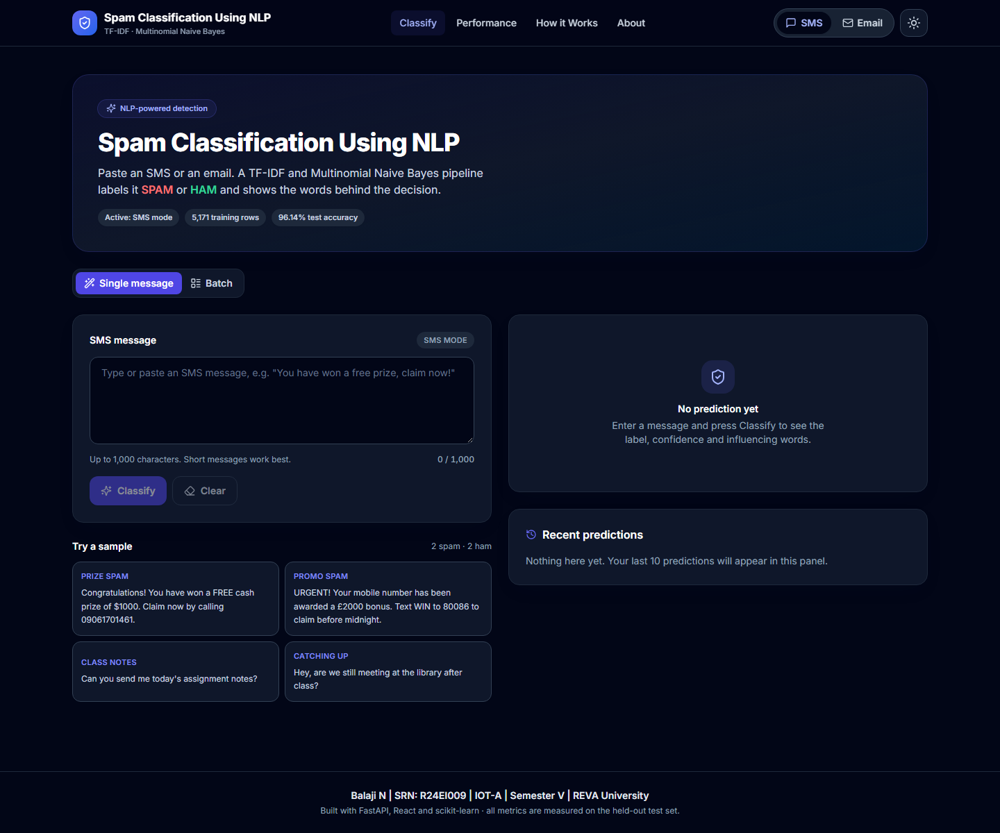
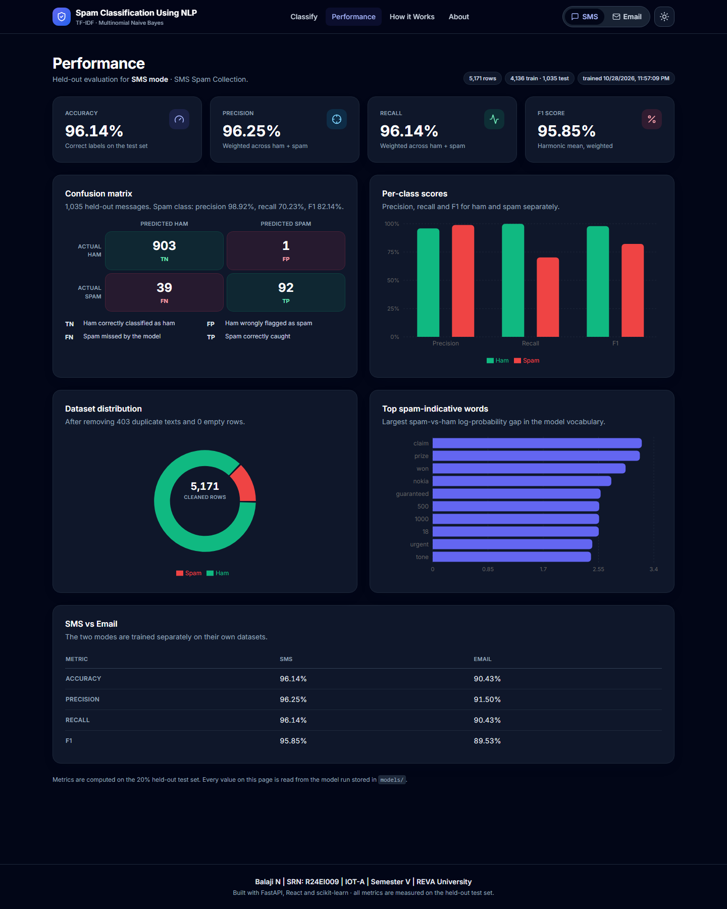

# Spam Classification Using NLP

Binary spam detection for **SMS messages** and **emails**, built with **FastAPI** and **React**.
Text goes through cleaning, lowercasing, tokenisation, TF-IDF and Multinomial Naive Bayes, and comes
out as **SPAM** or **HAM** with a probability and the words that influenced the decision.

SMS and email are separate models: each mode has its own dataset, vectorizer, model and evaluation
report, so the two domains never share vocabulary or statistics.

> **Balaji N | SRN: R24EI009 | IOT-A | Semester V | REVA University**

---

## Overview

- Two independent classifiers behind one interface, switchable in the navbar (persisted in `localStorage`).
- Single-message classification with confidence, cleaned text and top contributing words.
- Batch classification (100 messages max) with CSV export.
- Performance dashboard driven entirely by the saved metrics of a real training run.
- The frontend is served by FastAPI in production, so one command runs the whole app.

## Screenshots

**Classify page**



**Performance dashboard**



A full assignment report with methodology, results and figures is available in
[`docs/REPORT.md`](docs/REPORT.md).

## Tech stack

| Layer | Tools |
| --- | --- |
| Backend | Python 3.10+, FastAPI, Uvicorn, Pydantic |
| ML | pandas, scikit-learn (TF-IDF + MultinomialNB), joblib |
| Frontend | React 18, Vite 5, Tailwind CSS 3, React Router 6, Recharts, lucide-react, react-hot-toast |
| Tests | pytest + FastAPI TestClient |

## Project structure

```
spam-classifier/
  backend/
    __init__.py
    main.py            # routes, CORS, serves frontend/dist
    data_loader.py     # auto-detecting loader for both datasets
    model.py           # train, evaluate, save, load, predict per mode
    preprocess.py      # preprocess_text (SMS + email variants)
    train.py           # CLI: python -m backend.train [--mode sms|email|all]
  data/
    spam.csv           # SMS Spam Collection
    email.csv          # email spam dataset
  models/              # generated artifacts
    sms_vectorizer.joblib, sms_model.joblib, sms_metrics.json
    email_vectorizer.joblib, email_model.joblib, email_metrics.json
  frontend/
    package.json, vite.config.js, tailwind.config.js, postcss.config.js, index.html
    src/
      main.jsx, App.jsx, index.css
      api/client.js
      context/ModeContext.jsx
      components/  (Navbar, ModeSwitch, ThemeToggle, ClassifierCard, ResultCard,
                    ConfidenceBar, WordChips, SampleMessages, BatchClassifier,
                    ResultsTable, HistoryPanel, StatCard, ConfusionMatrix,
                    MetricsChart, DatasetChart, TopWordsChart, PipelineSteps,
                    Footer, Loader, ErrorState)
      pages/       (Classify.jsx, Performance.jsx, HowItWorks.jsx, About.jsx)
      hooks/       (useTheme.js, useHistory.js, useMetrics.js)
  tests/
    conftest.py
    test_api.py
  requirements.txt
  README.md
  .gitignore
```

## Setup

### 1. Backend

```bash
python -m venv .venv
# Windows (bash / Git Bash)
source .venv/Scripts/activate
# macOS / Linux
# source .venv/bin/activate

pip install -r requirements.txt
```

### 2. Datasets

Place the files here:

```
data/spam.csv     # SMS dataset
data/email.csv    # email dataset
```

The loader auto-detects the text and label columns (see [Dataset notes](#dataset-notes)), so the exact
column names do not need to match. If a file is missing, only that mode is disabled; the app and the
other mode keep working.

### 3. Models

Models train automatically the first time the API starts, or manually:

```bash
python -m backend.train --mode all      # or --mode sms / --mode email
```

Artifacts are written to `models/`: `<mode>_vectorizer.joblib`, `<mode>_model.joblib`,
`<mode>_metrics.json`.

### 4. Frontend

```bash
cd frontend
npm install
```

## Running the app

### Development

Two terminals:

```bash
# terminal 1 - API on http://localhost:8000
uvicorn backend.main:app --reload --port 8000
```

```bash
# terminal 2 - UI on http://localhost:5173 (proxies /api to 8000)
cd frontend
npm run dev
```

### Production (single server)

```bash
cd frontend
npm run build          # writes frontend/dist
cd ..
uvicorn backend.main:app --host 0.0.0.0 --port 8000
```

Open <http://localhost:8000>. FastAPI serves the built assets and falls back to `index.html` for
client-side routes. `npm run preview` is available too, but it does not proxy `/api` unless the API is
reachable at the same origin.

## API reference

All endpoints are under `/api`. Interactive docs: <http://localhost:8000/docs>.

| Method | Endpoint | Description |
| --- | --- | --- |
| GET | `/api/health` | Liveness plus per-mode availability |
| GET | `/api/modes` | Modes, availability, dataset size, accuracy, error |
| POST | `/api/predict` | Classify one message |
| POST | `/api/predict-batch` | Classify up to 100 messages |
| GET | `/api/metrics?mode=sms\|email` | Saved evaluation metrics |
| GET | `/api/dataset-stats?mode=sms\|email` | Dataset summary from the training run |
| POST | `/api/retrain?mode=sms\|email\|all` | Retrain and refresh artifacts |

### `POST /api/predict`

```bash
curl -X POST http://localhost:8000/api/predict \
  -H "Content-Type: application/json" \
  -d '{"message": "Congratulations! You won a free prize. Claim now!", "mode": "sms"}'
```

```json
{
  "mode": "sms",
  "label": "SPAM",
  "spam_probability": 0.9702,
  "ham_probability": 0.0298,
  "cleaned_text": "congratulations you won a free prize claim now",
  "top_contributing_words": [
    { "word": "claim", "weight": 3.2156 },
    { "word": "prize", "weight": 3.1859 }
  ]
}
```

`weight` is the Naive Bayes log-probability difference between spam and ham for that token: positive
pushes towards spam, negative towards ham.

### `POST /api/predict-batch`

```json
{ "messages": ["message one", "message two"], "mode": "sms" }
```

Returns `results` (with `index`, `message`, `label`, probabilities, cleaned text, words) and a
`summary` of totals.

### Validation and status codes

| Situation | Status |
| --- | --- |
| Empty message | 400 |
| Over 1,000 chars (SMS) or 10,000 chars (email) | 400 |
| Invalid `mode` | 400 |
| More than 100 batch messages, or an empty batch | 400 |
| Mode's dataset/model unavailable | 503 |
| Unexpected server error | 500 |

## Preprocessing

`backend/preprocess.py` implements exactly this shared pipeline:

```python
text = text.lower()
text = re.sub(r"[^a-zA-Z0-9\s]", "", text)
text = re.sub(r"\s+", " ", text).strip()
```

**Email mode adds three steps before the shared pipeline**, because email bodies carry markup and
tracking links:

1. HTML tags are removed (`<p>`, `<br>`, ...).
2. URLs are replaced with the token `urltoken`.
3. Email addresses are replaced with the token `emailtoken`.

This is applied identically during training and inference.

## Model and evaluation

- Stratified split: `train_test_split(test_size=0.2, random_state=42, stratify=label)`.
- `TfidfVectorizer(stop_words="english")`, fit on the training split only, then used to transform the test split.
- `MultinomialNB()` (default `alpha=1.0`).
- Reported metrics are computed on the **20% held-out test set** only.

| Metric | Meaning |
| --- | --- |
| Accuracy | Share of all test messages labelled correctly. |
| Precision (weighted) | Of the messages predicted as a class, how many were right; averaged by class support. |
| Recall (weighted) | Of the messages that truly belong to a class, how many were found; averaged by support. |
| F1 (weighted) | Harmonic mean of precision and recall, averaged by support. |
| TN / FP / FN / TP | Ham correct / ham flagged as spam / spam missed / spam caught. |

The dashboard also shows **per-class** precision, recall and F1 for ham and spam. For a spam filter,
**spam-class recall** (how much spam is caught) and **spam-class precision** (how often a spam flag is
correct) matter most.

> **Reporting these numbers:** every figure in the UI and below comes from this project's own training
> run. A cited reference study's accuracy is a separate result and is not this implementation's metric.

## Results (measured, not hardcoded)

Generated with `python -m backend.train --mode all` on the datasets in `data/`.

### SMS mode — SMS Spam Collection

| Metric | Value |
| --- | --- |
| Accuracy | **96.14%** |
| Precision (weighted) | 96.25% |
| Recall (weighted) | 96.14% |
| F1 (weighted) | 95.85% |
| Spam precision / recall / F1 | 98.92% / **70.23%** / 82.14% |
| Ham precision / recall / F1 | 95.86% / 99.89% / 97.83% |
| Confusion matrix | TN 903 · FP 1 · FN 39 · TP 92 |
| Rows | 5,574 loaded → 5,171 after removing 403 duplicate texts |
| Spam / ham | 653 / 4,518 |
| Train / test | 4,136 / 1,035 (131 spam in test) |
| Average text length | 79.33 characters |

### Email mode — Email Spam Dataset

| Metric | Value |
| --- | --- |
| Accuracy | **90.43%** |
| Precision (weighted) | 91.50% |
| Recall (weighted) | 90.43% |
| F1 (weighted) | 89.53% |
| Spam precision / recall / F1 | 100.00% / **60.22%** / 75.17% |
| Ham precision / recall / F1 | 88.81% / 100.00% / 94.07% |
| Confusion matrix | TN 865 · FP 0 · FN 109 · TP 165 |
| Rows | 5,728 loaded → 5,695 after removing 33 duplicate texts |
| Spam / ham | 1,368 / 4,327 |
| Train / test | 4,556 / 1,139 (274 spam in test) |
| Average text length | 1,558.07 characters |

Email spam recall is lower than SMS: the dataset is ham-heavy (76% ham) and the default Naive Bayes
prior is conservative, so borderline emails are labelled ham. This is reported as measured; the
limitation is discussed on the About page.

## Dataset notes

Both files were inspected before training and are loaded generically:

| | SMS | Email |
| --- | --- | --- |
| File | `data/spam.csv` | `data/email.csv` |
| Loaded rows | 5,574 | 5,728 |
| Columns as shipped | `v1`, `v2`, `Unnamed: 2`, `Unnamed: 3`, `Unnamed: 4` | `text`, `spam` |
| Detected text column | `v2` | `text` |
| Detected label column | `v1` | `spam` |
| Label mapping | `ham` → 0, `spam` → 1 | `0` → ham, `1` → spam |
| Dropped columns | 3 completely empty `Unnamed` columns | none |
| Encoding | UTF-8 (latin-1 fallback supported) | UTF-8 (latin-1 fallback supported) |
| Duplicate texts removed before split | 403 | 33 |
| Null / empty rows removed | 0 | 0 |
| Rows used | 5,171 | 5,695 |

Label handling accepts `ham`/`spam`, `legitimate`/`spam`, `not spam`/`spam`, `yes`/`no`, `true`/`false`
and numeric `0`/`1`. Anything else raises a clear error instead of guessing.

**Provenance:** at the start of this build the repository contained only `emails.csv` at the root. It was
moved to `data/email.csv`. The SMS file was not present, so `data/spam.csv` was generated from the public
**UCI SMS Spam Collection** (5,574 rows), keeping the classic `v1`/`v2` layout with three empty unnamed
columns.

The SMS dataset is class-imbalanced (≈87% ham), and duplicates are removed before splitting to avoid
data leakage and inflated accuracy.

## Tests

```bash
python -m pytest tests -q
```

Covers: health, mode availability, spam/ham predictions for **both** modes, empty and over-length
validation, invalid mode, metrics payload integrity, dataset stats, batch classification and its limits,
and SPA serving when a build exists. 20 tests pass.

## Development notes

- `backend/main.py` never crashes when a dataset or model is broken: startup isolates each mode and
  `/api/modes` explains what failed; the switch disables that mode with a tooltip.
- Models are cached in memory after loading; retraining via the API refreshes the cache and registry.
- CORS allows the Vite dev origins (`localhost:5173`, `127.0.0.1:5173`).
- `models/*.joblib` are git-ignored because they are reproducible with `python -m backend.train`.
- No secrets or `.env` files are required.

## Author

Balaji N | SRN: R24EI009 | IOT-A | Semester V | REVA University
