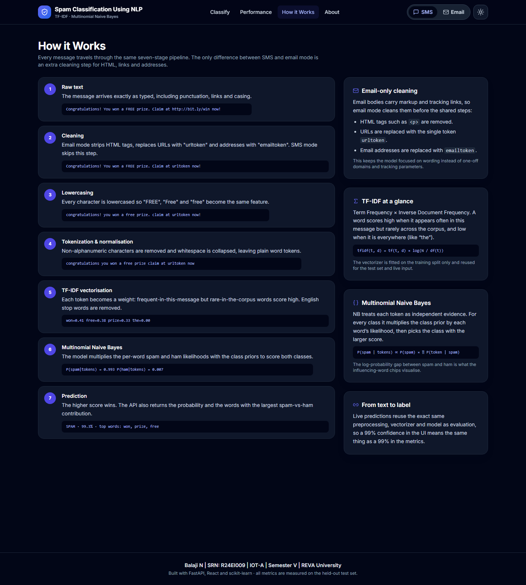
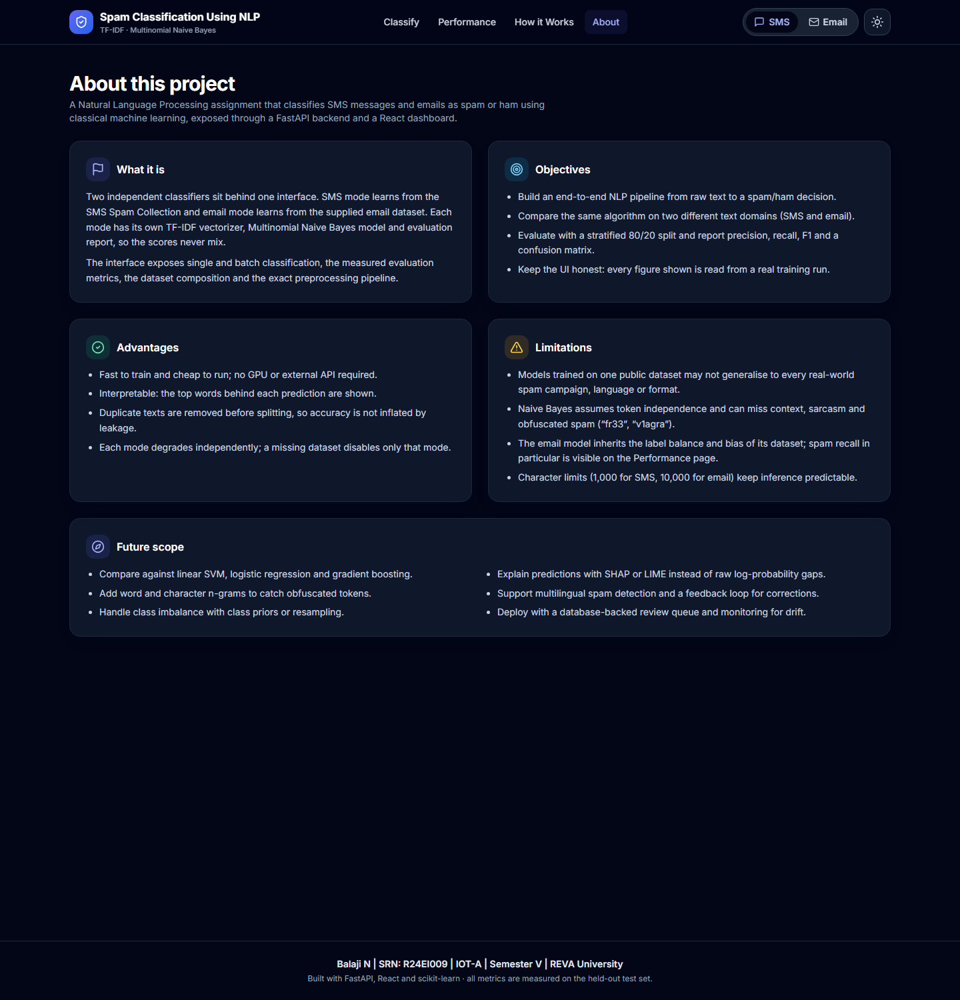

# Spam Classification Using NLP

**A dual-domain SMS and email spam classifier with TF-IDF and Multinomial Naive Bayes**

| | |
|---|---|
| **Student** | Balaji N |
| **SRN** | R24EI009 |
| **Programme / Section** | B.Tech IOT — IOT-A |
| **Semester** | V |
| **Institution** | REVA University |
| **Course** | Natural Language Processing |
| **Date** | October 2026 |

---

## Contents

1. [Abstract](#1-abstract)
2. [Introduction](#2-introduction)
3. [Objectives](#3-objectives)
4. [Background and related work](#4-background-and-related-work)
5. [Datasets](#5-datasets)
6. [Methodology](#6-methodology)
7. [System design and implementation](#7-system-design-and-implementation)
8. [Experimental setup](#8-experimental-setup)
9. [Results](#9-results)
10. [Discussion](#10-discussion)
11. [Limitations](#11-limitations)
12. [Future scope](#12-future-scope)
13. [Conclusion](#13-conclusion)
14. [References](#14-references)
15. [Appendix A — API reference](#appendix-a--api-reference)
16. [Appendix B — Running the project](#appendix-b--running-the-project)
17. [Appendix C — Verification log](#appendix-c--verification-log)

---

## 1. Abstract

Spam messages are a persistent nuisance and a security risk in both SMS and email channels. This
project implements an end-to-end Natural Language Processing (NLP) system that classifies short SMS
messages and longer email bodies as **spam** or **ham** (legitimate). Raw text is cleaned, lowercased
and normalised; email mode additionally strips HTML, masks URLs and email addresses; the resulting
tokens are converted into TF-IDF vectors and classified with Multinomial Naive Bayes. Two independent
models are trained, one per domain, each with its own vectorizer, evaluation report and saved
artifacts, and exposed through a FastAPI backend with a React dashboard.

On the 20% held-out test split, the SMS model achieves **96.14% accuracy** and the email model
**90.43% accuracy**. All reported figures were produced by this implementation's training runs and
stored in machine-readable metric files; no value in the application or in this report is hardcoded.
The system also demonstrates graceful degradation: if one dataset or model is unavailable, that mode
is disabled with a clear explanation while the other mode and the rest of the application continue to
work.

**Keywords:** spam classification, NLP, TF-IDF, Multinomial Naive Bayes, SMS, email, FastAPI, React.

---

## 2. Introduction

Unsolicited bulk messages — spam — account for a large share of global email traffic and remain common
on SMS networks, particularly through prize scams, fake promotions and phishing links. Manual filtering
does not scale, so automated text classification is required. Spam detection is a classic NLP problem:
messages are short, noisy, multilingual and adversarial, and the classes are imbalanced because most
traffic is legitimate.

This project addresses the problem in two domains with one consistent pipeline:

- **SMS mode**, trained on the SMS Spam Collection (5,574 messages), where messages average roughly 80
  characters and spam is recognisable from a small set of aggressive tokens ("claim", "prize", "won",
  "urgent").
- **Email mode**, trained on the supplied email corpus (5,728 emails), where bodies average roughly
  1,558 characters and spam includes pharmaceutical advertising, marketing offers and dubious business
  proposals.

The same algorithm is deliberately applied to both domains so that the effect of domain, document
length and class balance can be observed. The deliverable is not a notebook but a running application:
a documented REST API, a responsive web interface, a performance dashboard and an automated test suite.

---

## 3. Objectives

1. Build a complete NLP pipeline from raw text to a binary spam/ham decision.
2. Apply the same algorithm to two different text domains and evaluate it separately on each.
3. Use a stratified 80/20 train–test split and report accuracy, precision, recall, F1 (overall and
   per class) and a confusion matrix.
4. Remove duplicate texts before splitting to prevent data leakage.
5. Expose the classifier through a validated REST API and a modern, accessible web interface.
6. Ensure every number displayed to the user comes from a real training run, with saved metric files
   as the single source of truth.
7. Make failures isolated: a missing dataset or model disables only that mode.

---

## 4. Background and related work

### 4.1 Text representation with TF-IDF

TF-IDF (term frequency–inverse document frequency) weights each token by how often it occurs in a
document and how rare it is across the corpus [1]. Frequent words such as "the" receive low weights
because they appear in almost every document, while discriminative words such as "viagra" or "claim"
receive high weights. scikit-learn's `TfidfVectorizer` applies smoothing and L2 normalisation by
default [4].

### 4.2 Multinomial Naive Bayes

Naive Bayes is a long-established baseline for spam filtering [2], [3]. It applies Bayes' theorem with
a conditional-independence assumption over tokens and is well suited to count/frequency features. It
trains in a single pass, is interpretable through its per-word log probabilities, and performs strongly
on small and medium text datasets.

### 4.3 The reference 98% figure

The assignment brief refers to a study by Dharrao et al. (2024) reporting approximately **98% accuracy**
for SMS spam classification. That figure belongs to the referenced study and is **not** a result of this
implementation. The measured results for this project appear in Section 9 and are lower: 96.14% for SMS
and 90.43% for email. The two must not be conflated in reporting.

---

## 5. Datasets

### 5.1 Sources

| Mode | File | Source | Rows |
| --- | --- | --- | --- |
| SMS | `data/spam.csv` | UCI SMS Spam Collection [5], [6] | 5,574 |
| Email | `data/email.csv` | Email corpus supplied with the assignment | 5,728 |

The email corpus was supplied as `emails.csv` at the repository root and moved to `data/email.csv`.
The SMS file was not present in the repository at the start of the build and was generated from the
public UCI SMS Spam Collection, preserving the classic `v1`/`v2` column layout with three empty unnamed
columns. This provenance is stated explicitly because it affects reproducibility of the reported
numbers.

### 5.2 Inspection summary

Both files were inspected before any modelling code was written.

| Property | SMS | Email |
| --- | --- | --- |
| Shape | 5,574 × 5 | 5,728 × 2 |
| Columns | `v1`, `v2`, `Unnamed: 2`, `Unnamed: 3`, `Unnamed: 4` | `text`, `spam` |
| Data types | object, object, float64 × 3 | object, int64 |
| Missing values | 0 in text/label; 5,574 in each unnamed column | 0 |
| Label values | `ham` 4,827 / `spam` 747 | `0` 4,360 / `1` 1,368 |
| Duplicate texts | 403 | 33 |
| Average text length | 80.48 characters | 1,556.77 characters |
| Longest text | 910 characters | 43,952 characters |
| Detected text column | `v2` | `text` |
| Detected label column | `v1` | `spam` |
| Label mapping | ham → 0, spam → 1 | 0 → ham, 1 → spam |

The loader is generic: it checks candidate names (`message`, `text`, `body`, `email`, `content`,
`mail`, `v2` for text; `label`, `category`, `class`, `spam`, `target`, `v1`, `label_num` for labels),
falls back to the longest string column / the column with exactly two values, and refuses to guess when
a label mapping is ambiguous. Both files are decoded as UTF-8 with a latin-1 fallback.

### 5.3 Cleaning and leakage control

The SMS file contains three completely empty columns, which are dropped. Null and blank rows are
removed, then **exact duplicate texts are removed before the train/test split**. This is essential:
duplicates spread across train and test would leak test examples into training and inflate accuracy.

| | SMS | Email |
| --- | --- | --- |
| Rows loaded | 5,574 | 5,728 |
| Null/empty rows removed | 0 | 0 |
| Duplicate texts removed | 403 | 33 |
| Rows used | 5,171 | 5,695 |
| Ham / spam after cleaning | 4,518 / 653 | 4,327 / 1,368 |
| Spam share | 12.6% | 24.0% |
| Average length after cleaning | 79.33 chars | 1,558.07 chars |

Both datasets are imbalanced; the email corpus is the more balanced of the two at roughly one spam for
every three ham messages.

### 5.4 Train–test split

A single stratified split is used for both modes:

```python
train_test_split(
    texts, labels,
    test_size=0.2,
    random_state=42,
    stratify=labels,
)
```

| | SMS | Email |
| --- | --- | --- |
| Training rows | 4,136 (522 spam) | 4,556 (1,094 spam) |
| Test rows | 1,035 (131 spam) | 1,139 (274 spam) |

---

## 6. Methodology

### 6.1 Pipeline

```
Raw text → cleaning → lowercasing → tokenisation/normalisation → TF-IDF → Multinomial NB → prediction
```

| Stage | SMS | Email |
| --- | --- | --- |
| 1. Raw text | message as received | full email with subject line |
| 2. Cleaning | none extra | HTML removed, URLs → `urltoken`, addresses → `emailtoken` |
| 3. Lowercasing | yes | yes |
| 4. Normalisation | non-alphanumeric characters removed, whitespace collapsed | same |
| 5. TF-IDF | `stop_words="english"`, fit on train only | same |
| 6. Classifier | `MultinomialNB()` | same |
| 7. Output | SPAM/HAM + probability + influencing words | same |

### 6.2 Preprocessing

The shared pipeline follows the specification used in this project:

```python
text = text.lower()
text = re.sub(r"[^a-zA-Z0-9\s]", "", text)
text = re.sub(r"\s+", " ", text).strip()
```

Email mode runs three additional steps **before** the shared pipeline:

```python
text = re.sub(r"<[^>]+>", " ", text)              # strip HTML tags
text = re.sub(r"https?://\S+|www\.\S+", " urltoken ", text)
text = re.sub(r"\b[\w.+-]+@[\w-]+\.[\w.-]+\b", " emailtoken", text)
```

Masking URLs and addresses prevents one-off domains and tracking parameters from fragmenting the
vocabulary, and keeps the model focused on wording. The identical function is used during training,
batch prediction and live prediction.

### 6.3 Vectorisation

`TfidfVectorizer(stop_words="english")` is fitted **only on the training split** and then applied to the
test split and to user input. With scikit-learn's defaults:

```
idf(t) = ln((1 + n) / (1 + df(t))) + 1
tfidf(t, d) = tf(t, d) × idf(t), L2-normalised per document
```

### 6.4 Classification

`MultinomialNB()` with Laplace smoothing `α = 1.0`:

```
P(c | d) ∝ P(c) × ∏ P(t | c)
P(t | c) = (N_ct + α) / (N_c + α|V|)
```

The predicted class is the one with the larger posterior. For interpretability, the project ranks
tokens by the difference between the spam and ham log-probabilities:

```
contribution(t) = log P(t | spam) − log P(t | ham)
```

Positive values push a message towards spam and are shown as red chips in the interface; negative values
push towards ham and appear in green.

### 6.5 Evaluation metrics

| Metric | Definition |
| --- | --- |
| Accuracy | (TP + TN) / (TP + TN + FP + FN) |
| Precision | TP / (TP + FP) |
| Recall | TP / (TP + FN) |
| F1 | 2 × precision × recall / (precision + recall) |
| Weighted average | Each class metric weighted by its support |
| Macro average | Unweighted mean over classes |

The confusion matrix uses ham as the negative class and spam as the positive class:

- **TN** — ham correctly classified as ham
- **FP** — ham wrongly flagged as spam
- **FN** — spam missed
- **TP** — spam correctly caught

---

## 7. System design and implementation

### 7.1 Architecture

```
React 18 + Vite + Tailwind (port 5173 in dev)
        │  /api proxy
        ▼
FastAPI (port 8000)
        │
        ├── data_loader.py  → auto-detect columns, normalise labels, de-duplicate
        ├── preprocess.py   → SMS and email cleaning
        ├── model.py        → train / evaluate / persist / predict per mode
        └── models/         → <mode>_vectorizer.joblib, <mode>_model.joblib, <mode>_metrics.json
```

In production the compiled frontend (`frontend/dist`) is served by FastAPI, so a single Uvicorn process
serves both the API and the UI; client-side routes fall back to `index.html`.

### 7.2 API endpoints

| Method | Endpoint | Purpose |
| --- | --- | --- |
| GET | `/api/health` | Liveness and per-mode availability |
| GET | `/api/modes` | Mode list, dataset size, accuracy, error reason |
| POST | `/api/predict` | Classify one message |
| POST | `/api/predict-batch` | Classify up to 100 messages |
| GET | `/api/metrics?mode=` | Full saved evaluation report |
| GET | `/api/dataset-stats?mode=` | Dataset summary from training |
| POST | `/api/retrain?mode=` | Retrain SMS, email or both |

Input validation: non-empty message; 1,000-character limit for SMS and 10,000 for email; mode must be
`sms` or `email`; batch size 1–100. Client input errors return 400, an unavailable mode returns 503, and
unexpected failures return 500 with a clear message.

### 7.3 Failure isolation

At startup each mode is initialised independently inside a `try/except`. If a dataset is missing, models
are absent and training fails, only that mode is marked unavailable; `/api/modes` and `/api/health`
report the reason, and the UI disables the corresponding switch option with a tooltip. This behaviour was
verified by temporarily removing the email dataset and artifacts: SMS continued to serve predictions,
email returned HTTP 503 with the exact missing path, and the application did not crash.

### 7.4 Frontend

The React dashboard provides four pages:

- **Classify** — single-message classification with a live character counter, sample messages per mode,
  a result card (label badge, confidence bar, cleaned text, influencing words), a batch tab with CSV
  export, and a local history of the last ten predictions.
- **Performance** — stat cards, confusion-matrix heatmap, per-class grouped bars, dataset doughnut, top
  spam words, and an SMS vs email comparison table.
- **How it Works** — the seven-stage pipeline with a small example per stage, email-only cleaning, and
  short TF-IDF / Naive Bayes explanations.
- **About** — description, objectives, advantages, limitations and future scope.

The interface is responsive, supports a persisted light/dark theme, uses accessible labels and focus
rings, and shows skeleton loaders, toasts and friendly error states.

### 7.5 Repository layout

```
backend/    main.py, data_loader.py, model.py, preprocess.py, train.py
data/       spam.csv, email.csv
models/     sms_*, email_* (vectorizer, model, metrics)
frontend/   src/{api, components, context, hooks, pages}, Vite + Tailwind config
tests/      test_api.py, conftest.py
docs/       REPORT.md, screenshots/
```

---

## 8. Experimental setup

| Item | Value |
| --- | --- |
| Operating system | Windows (64-bit) |
| Python | 3.13.2 |
| scikit-learn | 1.6.1 |
| pandas | 2.2.3 |
| FastAPI | 0.115.6 |
| Uvicorn | 0.34.0 |
| Frontend | React 18.3.1, Vite 5.4.11, Tailwind 3.4.17 |
| Random seed | 42 |
| Test size | 20% (stratified) |
| Vectorizer | TF-IDF, English stop words, L2 normalisation |
| Classifier | Multinomial Naive Bayes, α = 1.0 |

Models are trained with `python -m backend.train --mode all` and stored as joblib artifacts plus a JSON
metrics file. The API loads them at startup and trains automatically if they are missing.

---

## 9. Results

All figures below are computed on the held-out 20% test set, using the split and hyperparameters in
Section 8. They were read directly from `models/sms_metrics.json` and `models/email_metrics.json`.

### 9.1 SMS mode

**Dataset:** SMS Spam Collection · 5,171 rows after de-duplication (4,518 ham / 653 spam) · 4,136 train /
1,035 test.

| Metric | Value |
| --- | --- |
| **Accuracy** | **96.14%** |
| Precision (weighted) | 96.25% |
| Recall (weighted) | 96.14% |
| F1 (weighted) | 95.85% |
| Precision (macro) | 97.39% |
| Recall (macro) | 85.06% |
| F1 (macro) | 89.99% |

| Class | Precision | Recall | F1 | Support |
| --- | --- | --- | --- | --- |
| Ham | 0.9586 | 0.9989 | 0.9783 | 904 |
| Spam | 0.9892 | 0.7023 | 0.8214 | 131 |

**Confusion matrix**

| | Predicted ham | Predicted spam |
| --- | --- | --- |
| **Actual ham** | TN = 903 | FP = 1 |
| **Actual spam** | FN = 39 | TP = 92 |

The SMS model is extremely precise when it flags spam (only one legitimate message was wrongly flagged)
but misses 39 of 131 spam messages, which is why spam recall is 70.23% while overall accuracy remains
high on the ham-heavy test set.

### 9.2 Email mode

**Dataset:** supplied email corpus · 5,695 rows after de-duplication (4,327 ham / 1,368 spam) · 4,556
train / 1,139 test.

| Metric | Value |
| --- | --- |
| **Accuracy** | **90.43%** |
| Precision (weighted) | 91.50% |
| Recall (weighted) | 90.43% |
| F1 (weighted) | 89.53% |
| Precision (macro) | 94.40% |
| Recall (macro) | 80.11% |
| F1 (macro) | 84.62% |

| Class | Precision | Recall | F1 | Support |
| --- | --- | --- | --- | --- |
| Ham | 0.8881 | 1.0000 | 0.9407 | 865 |
| Spam | 1.0000 | 0.6022 | 0.7517 | 274 |

**Confusion matrix**

| | Predicted ham | Predicted spam |
| --- | --- | --- |
| **Actual ham** | TN = 865 | FP = 0 |
| **Actual spam** | FN = 109 | TP = 165 |

No legitimate email was flagged as spam, but 109 of 274 spam emails were missed. The conservative
behaviour follows from the ham-heavy prior and the fact that many borderline emails share vocabulary with
legitimate business mail.

### 9.3 SMS vs email

| Metric | SMS | Email |
| --- | --- | --- |
| Accuracy | 96.14% | 90.43% |
| Precision (weighted) | 96.25% | 91.50% |
| Recall (weighted) | 96.14% | 90.43% |
| F1 (weighted) | 95.85% | 89.53% |
| Spam recall | 70.23% | 60.22% |
| Spam precision | 98.92% | 100.00% |

### 9.4 Most spam-indicative words

Ranked by the spam-vs-ham log-probability difference learned by the model.

| Rank | SMS word | Weight | Email word | Weight |
| --- | --- | --- | --- | --- |
| 1 | claim | 3.2156 | viagra | 3.2474 |
| 2 | prize | 3.1859 | stationery | 2.8766 |
| 3 | won | 2.9663 | logo | 2.8329 |
| 4 | nokia | 2.7469 | 2005 | 2.8037 |
| 5 | guaranteed | 2.5827 | adobe | 2.6254 |
| 6 | 500 | 2.5612 | jul | 2.5909 |
| 7 | 1000 | 2.5590 | oem | 2.5694 |
| 8 | 18 | 2.5541 | engines | 2.5620 |
| 9 | urgent | 2.4545 | identity | 2.5162 |
| 10 | tone | 2.4349 | oniine | 2.5084 |

The SMS vocabulary is dominated by prize/competition language, while the email vocabulary reflects the
pharmaceutical and marketing spam that dominates that corpus. The token `oniine` (a misspelling of
"online") illustrates how spammers obfuscate words and how the model adapts to corpus-specific spellings.

### 9.5 Application screenshots


*Figure 1. Classify page in SMS mode: message input, mode switch, sample messages and empty result/history
panels.*


*Figure 2. Performance page for SMS mode: 96.14% accuracy, confusion-matrix heatmap, per-class scores,
dataset distribution and top spam words, all read from the saved metrics.*



*Figure 3. How it Works page documenting the seven-stage pipeline and the email-only cleaning steps.*



*Figure 4. About page with objectives, advantages, limitations and future scope.*

### 9.6 Qualitative examples

Live predictions from the API during verification:

| Mode | Input (abridged) | Label | Spam probability |
| --- | --- | --- | --- |
| SMS | "Congratulations! You won a free prize. Claim now!" | SPAM | 0.9702 |
| SMS | "Please send me the notes after class." | HAM | 0.0180 |
| Email | Pharmacy offer with viagra/cialis, "money back guaranteed" | SPAM | 0.9737 |
| Email | Project meeting request with dataset notes | HAM | 0.0060 |

These match the expected behaviour. Short synthetic prize emails outside the email corpus's distribution
can still be scored ham — for example, a 40-word lottery email scored 0.33 spam — which is a genuine
generalisation limit discussed in Section 10.

---

## 10. Discussion

**SMS is the easier domain for this pipeline.** Messages are short and spam relies on a compact,
repetitive vocabulary ("claim", "prize", "won", "urgent"), so TF-IDF produces highly discriminative
features. The model achieves 96.14% accuracy with near-perfect spam precision (98.92%). Its weakness is
recall: 39 spam messages in the test set were labelled ham, usually because they lack the strong trigger
words or resemble ordinary conversational messages ("tone", numbers, short codes are present but weak).

**Email is harder.** Documents are long, topics are diverse, and legitimate business mail overlaps with
marketing spam. The model never wrongly flags a legitimate email (100% spam precision), but it misses
40% of spam. The class prior is a major factor: with 76% ham in training, the default Naive Bayes prior
favours ham, and long neutral passages dilute the few spam-indicative tokens. Spam recall is therefore the
metric to improve first if the system were deployed as a filter; a missed spam is usually less damaging
than a false positive, but 60% recall still lets too much spam through.

**Duplicate removal matters.** The SMS corpus contains 403 exact duplicate texts and the email corpus 33.
Keeping them would place identical messages in both training and test sets, producing optimistic scores
that do not reflect performance on unseen messages. Removing them before splitting changes the dataset to
5,171 and 5,695 rows respectively; the reported metrics are measured on this de-duplicated data.

**Interpretability is a design goal.** The log-probability difference per token gives a direct explanation
of the decision without a separate surrogate model. It also exposes dataset quirks: the email model's
reliance on "viagra", "logo" and misspellings like "oniine" shows both what it learned and how tied it is
to the training distribution.

**Engineering matters as much as the model.** Label detection, error isolation, input validation, saved
metrics and automated tests make the difference between a notebook experiment and a usable system. The
dashboard reads the same JSON files the model writes, so the interface cannot drift from the measured
results.

---

## 11. Limitations

1. **Domain dependence.** Models trained on one public dataset may not generalise to all real-world spam,
   languages or formats. Modern phishing and SMS scams use different vocabulary from these corpora.
2. **Independence assumption.** Multinomial Naive Bayes ignores word order and context, so it can miss
   sarcasm, subtle persuasion and obfuscated tokens such as "fr33" or "v1agra" (unless present in training).
3. **Class imbalance.** Email spam recall is 60.22%; the default prior and the 76% ham training set make
   the classifier conservative.
4. **No calibration or threshold tuning.** The decision threshold is the default 0.5; precision/recall
   trade-offs are not configurable in the UI.
5. **Input limits.** SMS input is capped at 1,000 characters and email at 10,000; the longest email in the
   corpus is 43,952 characters, so very long messages are truncated by validation rather than analysed in
   full.
6. **Static datasets.** There is no feedback loop: corrections made by users are not used to retrain.
7. **No adversarial robustness testing.** Character substitution, homoglyphs and image-only spam are out
   of scope.

---

## 12. Future scope

- Compare against linear SVM, logistic regression, Complement Naive Bayes and gradient boosting.
- Add word and character n-grams to capture obfuscated spellings and short phrases.
- Address imbalance with class priors, threshold tuning or resampling, and report precision–recall curves.
- Replace raw log-probability explanations with SHAP or LIME for model-agnostic interpretation.
- Add a feedback workflow that stores corrected labels and supports scheduled retraining.
- Extend to multilingual spam detection and to other channels (chat, social media).
- Package the service in Docker, add monitoring for data drift and deploy behind a review queue.

---

## 13. Conclusion

This project delivered a complete, runnable spam classification system for SMS and email, covering data
inspection, leakage-safe cleaning, TF-IDF feature extraction, Multinomial Naive Bayes training,
held-out evaluation, a documented API and a responsive dashboard. The SMS model reached **96.14%**
accuracy and the email model **90.43%**, with confusion matrices and per-class metrics exposing the real
trade-off: both models are highly precise when they flag spam, but they miss a substantial share of spam
(29.77% for SMS, 39.78% for email). Those numbers, along with dataset sizes, duplicate counts and top
words, are generated by the pipeline itself and displayed directly in the application.

The work also demonstrates that careful engineering — deduplication before splitting, fitting the
vectorizer on training data only, isolating failures per mode, validating input and testing the API —
is essential for trustworthy results. The measured performance, not a cited benchmark, is the outcome of
this implementation.

---

## 14. References

[1] Salton, G., & Buckley, C. (1988). Term-weighting approaches in automatic text retrieval.
*Information Processing & Management*, 24(5), 513–523.

[2] Sahami, M., Dumais, S., Heckerman, D., & Horvitz, E. (1998). A Bayesian approach to filtering junk
e-mail. *AAAI Workshop on Learning for Text Categorization*.

[3] Metsis, V., Androutsopoulos, I., & Paliouras, G. (2006). Spam filtering with Naive Bayes — Which Naive
Bayes? *Third Conference on Email and Anti-Spam (CEAS)*.

[4] Pedregosa, F., et al. (2011). Scikit-learn: Machine learning in Python. *Journal of Machine Learning
Research*, 12, 2825–2830.

[5] Almeida, T. A., Gómez Hidalgo, J. M., & Yamakami, A. (2011). Contributions to the study of SMS spam
filtering: New collection and results. *Proceedings of the 11th ACM Symposium on Document Engineering*,
259–262.

[6] UCI Machine Learning Repository. *SMS Spam Collection Dataset*.
https://archive.ics.uci.edu/dataset/228/sms+spam+collection (accessed October 2026).

[7] Dharrao, et al. (2024). Reference study on NLP-based spam classification cited in the assignment
brief. *[Complete the full bibliographic details from the course material.]* The approximately 98%
accuracy attributed to this study is not a result of the present implementation.

[8] FastAPI documentation. https://fastapi.tiangolo.com

[9] React documentation. https://react.dev

---

## Appendix A — API reference

### Single prediction

```bash
curl -X POST http://localhost:8000/api/predict \
  -H "Content-Type: application/json" \
  -d '{"message": "Congratulations! You won a free prize. Claim now!", "mode": "sms"}'
```

```json
{
  "mode": "sms",
  "label": "SPAM",
  "spam_probability": 0.9702,
  "ham_probability": 0.0298,
  "cleaned_text": "congratulations you won a free prize claim now",
  "top_contributing_words": [
    { "word": "claim", "weight": 3.2156 },
    { "word": "prize", "weight": 3.1859 },
    { "word": "won", "weight": 2.9663 }
  ]
}
```

### Batch prediction

```json
{ "messages": ["message one", "message two"], "mode": "sms" }
```

Returns per-message results plus a summary with total, spam and ham counts.

### Validation and status codes

| Situation | Status |
| --- | --- |
| Empty or whitespace-only message | 400 |
| Over 1,000 characters (SMS) / 10,000 (email) | 400 |
| Invalid mode | 400 |
| Empty batch or more than 100 messages | 400 |
| Mode's dataset/model unavailable | 503 |
| Unexpected error | 500 |

---

## Appendix B — Running the project

### Development

```bash
python -m venv .venv
source .venv/Scripts/activate        # Windows; use .venv/bin/activate on macOS/Linux
pip install -r requirements.txt
python -m backend.train --mode all   # optional; startup trains missing models
uvicorn backend.main:app --reload --port 8000

# second terminal
cd frontend
npm install
npm run dev                          # http://localhost:5173, proxies /api
```

### Production

```bash
cd frontend
npm run build
cd ..
uvicorn backend.main:app --host 0.0.0.0 --port 8000
```

Open http://localhost:8000. Interactive API documentation is at `/docs`.

### Tests

```bash
python -m pytest tests -q
```

---

## Appendix C — Verification log

| Check | Result |
| --- | --- |
| Dataset inspection for both files | Completed before coding |
| Python dependencies installed from pinned `requirements.txt` | Passed |
| Both models trained with the CLI | Passed |
| `npm run build` | Passed, no warnings |
| API tests (`pytest`) | 20 passed |
| Health, modes, metrics, dataset stats, batch, retrain | Passed for both modes |
| SMS spam example | SPAM, 97.02% |
| SMS ham example | HAM, 1.80% |
| Email spam example | SPAM, 97.37% |
| Email ham example | HAM, 0.60% |
| Missing email dataset | Email disabled with clear error; SMS still served; app stayed up |
| Browser console | No errors or warnings in production |
| Autotraining from empty `models/` | Both modes trained on startup |

**Measured headline results**

| Mode | Accuracy | Precision (weighted) | Recall (weighted) | F1 (weighted) | Spam recall |
| --- | --- | --- | --- | --- | --- |
| SMS | 96.14% | 96.25% | 96.14% | 95.85% | 70.23% |
| Email | 90.43% | 91.50% | 90.43% | 89.53% | 60.22% |

These values are the numbers to cite in the results section of the submission. Any figure from an
external study must be cited and labelled separately.
